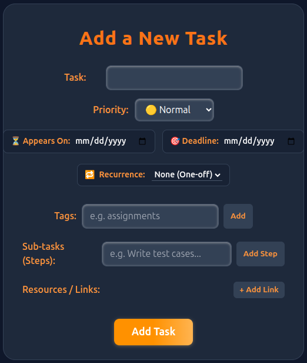
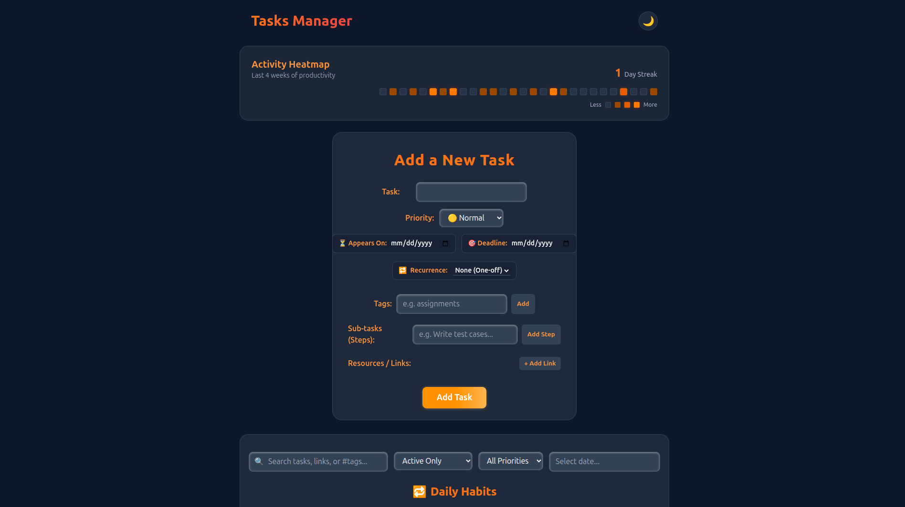
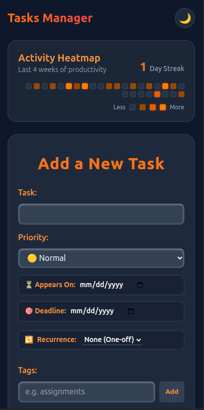

# TaskVault

A modern full-stack productivity and task management platform built with React, Supabase, and real-time synchronization.

TaskVault is designed for high-performance personal productivity with features like recurring habits, smart task organization, realtime sync, biometric vault locking, analytics, consistency tracking, and responsive cross-device experience.

---

## 🚀 Live Demo

https://tasks-manager-coral.vercel.app/

---

# Overview

TaskVault is a modern productivity platform focused on speed, security and user experience.

Unlike traditional todo applications, TaskVault combines intelligent task management with real-time cloud synchronization, analytics, recurring habits, biometric vault protection and a polished responsive interface.

Designed with a modular architecture, the project emphasizes scalability, maintainability and production-ready engineering practices.

---

# Features

## Productivity

* Create, edit and delete tasks
* Priority management (Urgent / Normal / Later)
* Deadlines and due-date tracking
* Start dates
* Inline editing
* Archive & restore tasks
* Task completion history
* Powerful search and filters

---

## Smart Task Management

* Automatic tag generation
* Custom tags
* Subtasks
* Resource links
* Recurring daily tasks
* Quick Add (keyboard shortcut)
* Task prioritization

---

## Codeforces Integration

* Automatic Codeforces contest synchronization
* User-controlled contest sync
* Duplicate contest prevention
* Contest reminders with subtasks
* Contest registration links

---

## Analytics

* Productivity dashboard
* Completion statistics
* Consistency heatmap
* Daily productivity insights
* Archive analytics support

---

## Security

* Google sign-in via Supabase Auth
* Row Level Security: each user can only access their own tasks
* Device-local Vault PIN (salted PBKDF2 hash, never uploaded)
* Attempt limiting with temporary lockouts and forced sign-out
* Auto-lock after inactivity
* Optional fingerprint / face unlock (WebAuthn)

---

## Realtime

* Supabase Realtime
* Instant synchronization
* Optimistic UI updates
* Multi-device synchronization

---

## User Experience

* Beautiful responsive UI
* Dark Mode
* Light Mode
* Mobile friendly
* Toast notifications
* Keyboard shortcuts
* Smooth animations
* Lazy loaded pages

---

# Tech Stack

## Frontend

* React
* React Router
* Tailwind CSS
* React Hot Toast

## Backend

* Supabase
* PostgreSQL
* Supabase Authentication
* Supabase Realtime

## Deployment

* Vercel

## Testing

* Vitest
* React Testing Library

---

# Architecture

```bash
src/
│
├── components/
├── pages/
├── hooks/
├── context/
├── layouts/
├── routes/
├── services/
├── tests/
├── utils/
└── ui/
```

Project follows a modular architecture with:

* Custom Hooks
* Context API
* Service Layer
* Protected Routes
* Reusable Components
* Lazy Loading
* Separation of Concerns

---

# Installation

Clone repository

```bash
git clone https://github.com/AtulBoyal/tasks-manager.git
```

Move into frontend

```bash
cd Tasks_Manager/frontend
```

Install dependencies

```bash
npm install
```

Create a `.env` file

```env
REACT_APP_SUPABASE_URL=YOUR_SUPABASE_URL
REACT_APP_SUPABASE_ANON_KEY=YOUR_SUPABASE_ANON_KEY
```

Run locally

```bash
npm start
```

Build production version

```bash
npm run build
```

Run tests

```bash
npm test
```

---

# Screenshots

* Dashboard
* Dark Mode
* Analytics
* Mobile View
* Archive
* Settings
* Vault Lock
* Focus Mode

```md






```

---

# Engineering Highlights

* Modular React architecture
* Production-ready folder structure
* Optimistic UI updates
* Real-time synchronization
* Context-driven state management
* Custom hooks abstraction
* Lazy loading
* Responsive design
* Protected route architecture
* Device-local Vault security
* Automatic recurring task engine
* Codeforces contest synchronization
* Automatic duplicate prevention

---

# Future Roadmap

* AI task prioritization
* AI schedule planning
* Google Calendar integration
* Outlook integration
* Team collaboration
* Shared workspaces
* Kanban board
* Offline mode
* PWA
* Push notifications
* Email reminders
* Drag & Drop support
* Natural language task creation
* AI productivity insights

---

# Security

* Authentication is handled by Supabase (Google OAuth).
* Data access is enforced server-side with Postgres Row Level Security.
* Environment files are excluded via `.gitignore`.

### About the Vault PIN

The Vault PIN is a **privacy lock for this device**, not encryption. Task data
is stored in Supabase and protected by your Google sign-in and Row Level
Security; the PIN stops someone using an already signed-in device from opening
the app.

* The PIN is stored only as a salted PBKDF2-SHA256 hash and never leaves the device.
* 5 wrong attempts trigger an escalating lockout; 10 sign you out of Google.
* "Forgot PIN" signs you out, so a new PIN can only be set after signing in with Google again.
* The vault locks automatically after 10 minutes of inactivity, and tasks are cleared from memory while locked.
* Fingerprint / face unlock uses a platform WebAuthn credential and never stores the PIN.

---

# Author

**Atul Boyal**

* IIT Hyderabad
* Computer Science & Engineering
* Full Stack Developer
* Systems Programming Enthusiast
* Competitive Programmer

---

# License

This project is licensed under the MIT License.
